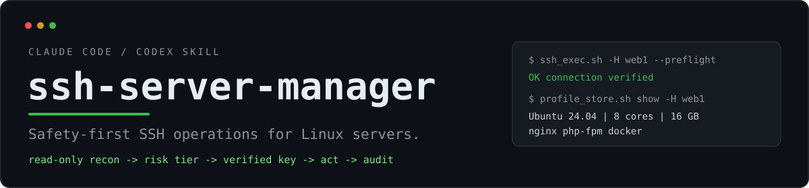
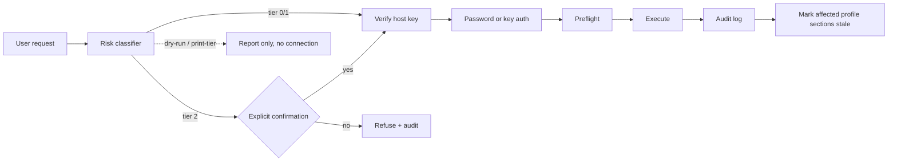

<div align="center">
  
  <br>
  <p><strong>Safety-first SSH operations for Linux servers.</strong><br>
  A Claude Code and Codex skill for operating remote hosts without turning one typo into an outage.</p>

  <p>
    <a href="https://github.com/youbilin/ssh-server-manager/actions/workflows/ci.yml"></a>
    <a href="LICENSE"></a>
    
    
    <a href="https://github.com/youbilin/ssh-server-manager/stargazers"></a>
  </p>

  <p>
    <a href="#quick-start">Quick start</a> ·
    <a href="#installation">Installation</a> ·
    <a href="#how-it-works">How it works</a> ·
    <a href="#safety-model">Safety model</a> ·
    <a href="#script-reference">Scripts</a> ·
    <a href="#compatibility">Compatibility</a> ·
    <a href="#faq">FAQ</a>
  </p>
</div>

---

## Why this exists

Most SSH tooling is optimized for **running a command**. This skill is optimized for **not regretting it**.

Remote operations fail in three specific ways, and each one is addressed by a mechanism rather than by asking the model to remember a rule:

| Failure mode | What goes wrong | Mechanism in this skill |
|---|---|---|
| Remote actions are hard to undo | A local `rm` may have a snapshot; a remote `rm -rf` usually has nothing | Risk tiers; dangerous commands are refused unless explicitly confirmed |
| SSH/network changes lock you out | One bad `sshd_config` or firewall flush leaves only the provider console | Backup, syntax check, rollback timer, and a documented escape hatch |
| Batch operations multiply mistakes | One wrong command on 50 hosts is an incident | Target list, explicit `--yes`, bounded concurrency, per-host failure report |

The result is a practical operations skill that still behaves like a careful engineer: **look first, explain the impact, act, verify, and leave a trail.**

## What you get

| Area | Capability | In practice |
|---|---|---|
| **Safety gate** | Read-only / mutating / dangerous classification | Dangerous operations require `--confirm-danger`; read-only inspection runs directly |
| **Password-first auth** | No key setup required | Uses OpenSSH's own `SSH_ASKPASS`; no `sshpass`, no password in argv, history, or audit log |
| **Exact host keys** | First contact is a deliberate trust decision | `--show-host-key` scans, `--accept-host-key --fingerprint SHA256:…` writes exactly one verified key |
| **Auditable execution** | Every wrapper command is recorded | `time \| host \| tier \| rc \| duration \| command`, escaped and append-only |
| **Server profiles** | Look once, then read the cache | Hardware, disks, network, services, Docker and sshd baseline; per-port files; fingerprint-first identity |
| **Health inspection** | Current state, not a re-inventory | CPU, memory, disk/inode, ports, failed systemd/OpenRC units, Docker, updates, verdict |
| **Audited transfers** | File moves use the same safety path | `--upload` / `--download` / `--recursive`, scp or rsync, password askpass and host-key checks included |
| **Batch execution** | One command across many hosts | Tag/alias selection, target preview, failure list, unique logs, JSON summary |
| **Portability** | macOS, Linux and Windows Git-Bash | Bash 3.2+; systemd Linux and Alpine/OpenRC (with `bash`); fake-based tests and CI |

## How it works



The order is intentional: `--dry-run`, `--print-tier` and `--selftest` never read credentials or open a connection; a dangerous command is refused **before** any authentication; and stdout/stderr are kept separate so structured payloads (profiles, health reports) are not polluted by SSH warnings.

## Quick start

Set `SKILL_DIR` to the installed skill folder, then run these from any working directory.

```bash
SKILL_DIR="$HOME/.claude/skills/ssh-server-manager"
```

**1. Validate the local environment.** This does not connect anywhere.

```bash
bash "$SKILL_DIR/scripts/ssh_exec.sh" --selftest
```

**2. Verify a new host key before trusting it.** Compare the printed fingerprint with the cloud console or an admin record.

```bash
bash "$SKILL_DIR/scripts/ssh_exec.sh" -H 203.0.113.10 --show-host-key
bash "$SKILL_DIR/scripts/ssh_exec.sh" -H 203.0.113.10 \
  --accept-host-key --fingerprint SHA256:xxxx
```

**3. Connect with a password.** The prompt never enters shell history.

```bash
bash "$SKILL_DIR/scripts/ssh_exec.sh" -H 203.0.113.10 -u root \
  --prompt-credential -c 'uptime'
```

Optional: save it per target for explicit later reuse.

```bash
bash "$SKILL_DIR/scripts/ssh_exec.sh" -H 203.0.113.10 -u root \
  --prompt-credential --save-credential -c 'uptime'
bash "$SKILL_DIR/scripts/ssh_exec.sh" -H 203.0.113.10 -u root \
  --use-saved-credential -c 'uptime'
```

**4. First contact: collect a read-only profile and print the portrait.**

```bash
bash "$SKILL_DIR/scripts/profile_store.sh" collect -H 203.0.113.10 -u root \
  --prompt-credential --note "prod web frontend"
```

```text
═══ 服务器画像 ═══
  系统             Ubuntu 24.04.4 LTS
  内核             Linux 6.8.0-xx-generic
  服务管理         systemd
  虚拟化           kvm
  CPU              Intel(R) Xeon(R) Platinum
  内存MB           16384
  机型             Alibaba Cloud ECS
  主IP             10.0.0.12
  Docker           present
  容器              6 个
  systemd服务       21 个在跑
  延迟avg          12
  上次采集         2026-10-22T06:00:00Z
```

The output above is illustrative. `show --short` renders the same shape from the local profile.

**5. Current state when it matters.**

```bash
bash "$SKILL_DIR/scripts/ssh_exec.sh" -H 203.0.113.10 \
  -f "$SKILL_DIR/scripts/health_check.sh" -t 180
```

The report ends with a machine-readable line:

```text
SSHMGR_VERDICT=OK|WARN|CRIT
```

**6. Audited file transfer.**

```bash
bash "$SKILL_DIR/scripts/ssh_exec.sh" -H 203.0.113.10 \
  --upload ./app.tar.gz /tmp/app.tar.gz
bash "$SKILL_DIR/scripts/ssh_exec.sh" -H 203.0.113.10 \
  --download /var/log/app.log ./
```

**7. Batches start with a preview.**

```bash
bash "$SKILL_DIR/scripts/batch_run.sh" \
  --inventory "$SKILL_DIR/assets/inventory.example.yaml" --tags web \
  --cmd 'systemctl is-active nginx' --parallel 5 --dry-run
```

## Installation

The repository ships two builds of the same skill. Scripts, references and assets are generated
byte-for-byte; only the `SKILL.md` and Codex UI metadata differ.

| Harness | Build | Install to |
|---|---|---|
| Claude Code | repository root | `~/.claude/skills/ssh-server-manager` |
| Codex | [`codex/`](codex/) | `~/.agents/skills/ssh-server-manager` |

### Claude Code

```bash
# macOS / Linux
git clone https://github.com/youbilin/ssh-server-manager.git \
  ~/.claude/skills/ssh-server-manager

# Windows Git-Bash
git clone https://github.com/youbilin/ssh-server-manager.git \
  "$USERPROFILE/.claude/skills/ssh-server-manager"
```

A symlink works too if you keep the working copy elsewhere. `SKILL.md` must sit at the root of
the installed folder.

### Codex

```bash
git clone https://github.com/youbilin/ssh-server-manager.git /tmp/ssm
mkdir -p ~/.agents/skills
cp -r /tmp/ssm/codex ~/.agents/skills/ssh-server-manager
```

For a single project, copy `codex/` to `<repo>/.agents/skills/ssh-server-manager` instead.
Codex scans project `.agents/skills` upward to the repository root, plus `~/.agents/skills`.

### First run

```bash
bash "$SKILL_DIR/scripts/ssh_exec.sh" --selftest
```

The self-test reports the ssh binary and version, askpass support, `/dev/tcp`, GNU `timeout` or
the built-in watchdog, helper tools, ControlMaster directory, and a transparent-proxy check.

## Core workflows

| Situation | Start here |
|---|---|
| **Website returns 502** | Quantify the 502s in `access.log`, read `error.log`, check the upstream service and port, then resources. Do not restart the service first. |
| **Disk is full** | Separate disk from inode exhaustion; locate usage layer by layer with `du -x`; check `lsof +L1` for deleted-but-open files; clean safest first. |
| **Service is down** | Read `journalctl -u <svc>` (or the service log on OpenRC) before restarting; identify port conflicts, config syntax, permissions, SELinux/AppArmor, or dependencies. |
| **Deploy a new version** | Record the current commit, back up configs, inspect incoming commits, `git pull --ff-only`, reload, health-check, and keep a rollback commit. |
| **Patch many hosts** | Preview the target list, inspect upgradable packages, pilot on one host, then roll out in batches with `--parallel 1 --stop-on-error`. |
| **Compare machines** | `profile_store.sh compare -H web1,web2` reads local profiles; no network traffic. |
| **Hardening** | Read `references/hardening.md`; change SSH/firewall rules in the reversible order with an out-of-band fallback. |

The full operating rules live in [`SKILL.md`](SKILL.md). The references are intentionally
load-on-demand, not required reading.

## Safety model

### Risk tiers

| Tier | Examples | Behaviour |
|---|---|---|
| **0 — read-only** | `df`, `journalctl`, `systemctl status`, `docker ps`, `cat /etc/ssh/sshd_config` | Runs directly |
| **1 — mutating** | `systemctl restart`, package installs, `chmod`, `sed -i`, `docker compose up` | Warns with blast radius; affected profile sections are marked stale |
| **2 — dangerous** | recursive deletes, `mkfs`, `dd`, partition tools, firewall flushes, `sshd_config`/`fstab`/`sudoers` edits, shutdown/reboot, benchmarks | Refused unless `--confirm-danger` is passed explicitly |

The classifier understands command position and common write targets. It is a **guardrail, not a
sandbox**: interpreter one-liners (`python -c`), dynamically assembled scripts, and arbitrary
binaries cannot be classified reliably. Read-only commands that merely *mention* a dangerous
word — `cat /etc/ssh/sshd_config`, `journalctl | grep reboot`, `ps aux | grep fio` — correctly
stay at tier 0.

### Host keys

Verification stays strict. A first connection is expected to fail until the host key is
verified:

```bash
# Print candidate fingerprints; write nothing.
ssh_exec.sh -H <host> --show-host-key

# Compare with the provider console, then write exactly the matching key.
ssh_exec.sh -H <host> --accept-host-key --fingerprint SHA256:...
```

`--fingerprint` must be complete and must match exactly; partial fingerprints, mismatches, and a
different existing `known_hosts` entry are refused. Jump hosts are a separate trust decision
and must already be trusted.

### Config-change protocol

For files where a mistake means "can't get in or won't boot" — `sshd_config`, `nginx.conf`,
firewall rules, `fstab`, `/etc/sudoers`:

1. Back up and verify the backup: `backup_config.sh -H <host> -f <path>`.
2. Syntax-check: `sshd -t`, `nginx -t`, `visudo -c`, `findmnt --verify`.
3. Keep the current SSH session open.
4. Arm an automatic rollback timer with `systemd-run --on-active=...`, then cancel it after verification.
5. Reload rather than restart, and verify from a second session.
6. Tell the user the out-of-band fallback (VNC/console) in advance.

### Server profiles

A profile stores **slow-moving facts only**: hardware, disks, network, services, Docker, sshd
baseline. Fast-moving state belongs in `health_check.sh`.

- Stored under `~/.ssh-server-manager/profiles/<target>.profile`, with a `_<port>` suffix for
  non-default SSH ports.
- Identity is the host-key fingerprint verified by the client, with `machine_id` as
  corroboration. A mismatch saves `.m2.profile` and exits 3; `--force` overrides after review.
- Lookups are exact-line matches (`web1` does not match `web10`); multiple ports require `-p`.
- Partial refreshes keep unaffected sections; only the refreshed sections clear their stale marker.
- `check` reports a reboot baseline and disk read/write deltas since collection.

### Transfers and batch

- `--upload` / `--download` reuse the wrapper's password askpass, strict host keys, tiering and
  audit. Downloads refuse to overwrite local paths unless `--force`; uploads to critical remote
  paths need `--confirm-danger`.
- Direct `scp` / `rsync` bypass the wrapper's audit, tiering and askpass flow. Use the wrapper for
  password-authenticated or one-off transfers; use direct `rsync` for bulk work only when that
  trade-off is acceptable.
- Every mutating batch requires `--yes`; dangerous batches also require `--confirm-danger`.
- Per-host logs are named by index, not alias; each run gets a unique directory. Add
  `--json-out FILE` for a machine-readable summary and `--prune-batches N` for explicit cleanup.

## Script reference

All scripts support `--help`.

| Script | Runs on | Purpose |
|---|---|---|
| [`ssh_exec.sh`](scripts/ssh_exec.sh) | Local | Execution wrapper: preflight, timeout, risk tiers, audit, transfer modes, error diagnosis |
| [`health_check.sh`](scripts/health_check.sh) | Target | Read-only health report ending in `SSHMGR_VERDICT` |
| [`batch_run.sh`](scripts/batch_run.sh) | Local | Multi-host runner with target preview, concurrency, failure list and JSON summary |
| [`backup_config.sh`](scripts/backup_config.sh) | Local + target | Timestamped config backup, checksum verification, ssh-wrapped restore command |
| [`profile_store.sh`](scripts/profile_store.sh) | Local | Collect, find, show, list, check, compare, set, mark-stale, forget |
| [`server_profile.sh`](scripts/server_profile.sh) | Target | Read-only profile collector (normally via `profile_store.sh`) |
| [`tcping.sh`](scripts/tcping.sh) | Local | TCP handshake latency probe; zero remote load |

### `ssh_exec.sh`

```bash
ssh_exec.sh -H web1 -c 'df -h'                          # read-only
ssh_exec.sh -H web1 --preflight                         # connectivity only
ssh_exec.sh -H web1 -f scripts/health_check.sh -t 180   # run a script remotely
ssh_exec.sh -H web1 --upload ./app.tgz /tmp/app.tgz     # audited upload
ssh_exec.sh -H web1 --download /var/log/app.log ./      # audited download
ssh_exec.sh -H web1 --rsync --recursive --upload ./dist /srv/app/dist
ssh_exec.sh -H web1 --dry-run -c 'rm -rf /tmp/x'        # no connection, no credentials
ssh_exec.sh --print-tier -c 'systemctl restart nginx'   # machine-readable tier: 0/1/2
ssh_exec.sh -H web1 --show-host-key                     # fingerprints, no write
```

Exit codes: `0` success · `124` timeout · `4` dangerous command not confirmed · `1` usage/local
error · `2` connection/authentication failure · other values pass through from the remote command.

### `health_check.sh`

Sections: `identity`, `cpu`, `memory`, `disk`, `network`, `services`, `security`, `logins`,
`docker`, `updates`.

```bash
ssh_exec.sh -H web1 -f scripts/health_check.sh -A '--sections cpu,memory,disk' -t 120
ssh_exec.sh -H web1 -f scripts/health_check.sh \
  -A '--disk-warn 75 --disk-crit 85 --load-warn 1.5' -t 180
```

Threshold flags: `--disk-warn/--disk-crit`, `--inode-warn/--inode-crit`,
`--load-warn/--load-crit`, `--mem-warn/--mem-crit`. The equivalent `SSHMGR_*` environment
variables work when the script runs directly on the host.

Only containers that are `Exited`, `Restarting`, `Dead`, `Paused`, `Created`, or `(unhealthy)` are
reported; a running container without a healthcheck is normal.

### `batch_run.sh`

```bash
batch_run.sh --hosts 'web1 web2' --cmd 'df -h' --parallel 2
batch_run.sh --hosts-file hosts.txt --cmd 'systemctl is-active nginx'
batch_run.sh --inventory inv.yaml --tags web --cmd 'uptime' --dry-run
batch_run.sh --from-ssh-config 'web*' --cmd 'uptime'
batch_run.sh --hosts-file hosts.txt --cmd 'uptime' --json-out result.json
batch_run.sh --hosts-file hosts.txt --cmd 'uptime' --prune-batches 10
```

Inventory entries may set `auth: auto|key|password`; command-line `--auth` overrides it.

### `backup_config.sh`

```bash
backup_config.sh -H web1 -f /etc/nginx/nginx.conf
backup_config.sh -H web1 -d /etc/nginx/sites-enabled --sudo
backup_config.sh -H web1 -f /etc/nginx/nginx.conf --list
```

Copies with a UTC timestamp, verifies SHA-256, and prints an ssh-wrapped restore command
followed by the matching syntax check and reload. `--keep N` requires `N >= 1`.

### `profile_store.sh`

```bash
profile_store.sh collect -H web1 --sections docker,services   # partial refresh
profile_store.sh find | show | list | check | compare | set | mark-stale | forget
profile_store.sh check -H web1      # reboot check + disk IO since collection
profile_store.sh compare -H web1,web2
```

Profiles are flat `key=value` files under `~/.ssh-server-manager/profiles/`. A `--sections`
collection is a partial refresh; omitted sections are carried over, and only refreshed sections
lose their stale marker. `collect` and `check` reuse stored user/port/jump/identity metadata and
accept the same password options as `ssh_exec.sh`.

## Configuration

| Variable | Default | Purpose |
|---|---|---|
| `SSHMGR_HOME` | `~/.ssh-server-manager` | Audit log, credentials, profiles and ControlMaster sockets |
| `SSHMGR_LOG_DIR` | same | Compatibility name for `SSHMGR_HOME` |
| `SSHMGR_LOG` | `$SSHMGR_HOME/audit.log` | Explicit audit log path |
| `SSHMGR_PASSWORD` | — | Password source; safer only if already exported in your own session |
| `SSHMGR_CREDENTIAL_FILE` | — | Default explicit credential file |
| `SSHMGR_SSH` | `ssh` | Override the ssh binary |
| `SSHMGR_SCP` | `scp` | Override the scp binary |
| `SSHMGR_RSYNC` | `rsync` | Override the rsync binary |
| `SSHMGR_ASKPASS_DEBUG` | `0` | Log askpass prompts (never passwords) to `askpass.log` |
| `SSHMGR_NO_MUX` | `0` | Disable ControlMaster multiplexing |
| `SSHMGR_AUDIT_MAX_BYTES` | `0` | Rotate `audit.log` when it exceeds this size |
| `SSHMGR_NO_TIMEOUT` | `0` | Force the built-in watchdog (testing/diagnostics) |
| `SSHMGR_NO_HINT` | `0` | Suppress profile hints on stderr |
| `SSHMGR_REQUIRE_KEY` | `0` | Treat password SSH auth as a WARN in `health_check` |

Credentials are not persisted by default. `--save-credential` writes a per-target file under
`credentials.d/`; `--use-saved-credential` reads it explicitly. The legacy global `credentials`
file remains readable but is deprecated.

## Compatibility

| Component | Supported |
|---|---|
| Local OS | Linux, macOS, Windows Git-Bash |
| Local shell | Bash 3.2+ (4+ recommended; the suite runs on macOS's 3.2) |
| Target OS | systemd Linux: Ubuntu/Debian, RHEL/CentOS/Rocky/Alma; Alpine/OpenRC with bash installed |
| Remote shell | `bash` (`ssh host bash -s`); Alpine requires `apk add bash` |
| Authentication | Password via `SSH_ASKPASS`, key/agent, `keyboard-interactive` fallback; no `sshpass` |
| Transfers | `scp` required; `rsync` optional |
| Optional tooling | `python3` + PyYAML for inventory parsing and `--json-out`; `rsync` for `--rsync` |
| Not supported | ash-only Alpine, non-Linux targets, interactive TUI sessions |

On Windows, run inside **Git-Bash**, not PowerShell with the native OpenSSH client. The native
`ssh.exe` cannot execute the POSIX askpass helper; `--selftest` detects and reports this case.

## Security model

- **No `sshpass -p`.** Passwords reach ssh through a private askpass helper and a temporary
  password file deleted on exit. They never enter argv, shell history, the audit log, or a profile.
- **Not persisted by default.** `--save-credential` is opt-in and writes per target under
  `credentials.d/`. Any process running as the same OS user can read it; file modes are not a
  boundary.
- **Strict host keys.** First contact requires an explicit fingerprint; the wrapper never disables
  verification or writes an unverified key.
- **Profiles and logs are infrastructure data.** They contain IPs, hostnames, image lists and
  service inventories. They live under `~/.ssh-server-manager/` and are excluded from git.
- **Never `source` or `eval` profile values.** Values originate on the target host; profiles are
  parsed line by line with validated key names.
- **`chmod 600` is often a no-op under Git-Bash.** Mounts with `noacl` do not honor POSIX modes;
  the scripts report the measured mode instead of printing a reassuring `0600`.
- **Not a sandbox.** `--confirm-danger` is a guardrail the agent can still pass. The human
  confirmation is the real gate. Audit logs are append-only, not tamper-evident; ship them
  off-box if compliance requires that.
- **Direct `scp`/`rsync` bypasses the wrapper's audit and askpass flow.** Use
  `ssh_exec.sh --upload/--download` when those properties matter.

## Testing

```bash
bash tests/run.sh
```

The suite needs no network and no real host: fake `ssh`, `ssh-keyscan`, `scp`, `rsync` and
`docker`, with host keys generated locally. It covers risk classification, credential lifecycle,
exact host-key matching, profile port/lookup/stale/identity/IO behavior, audited transfers,
Docker health, batch JSON/prune/confirmation, OpenRC service detection and eval fixture shape.

CI runs on Ubuntu, macOS and Windows Git-Bash, plus `shellcheck`, a BSD/onetrue-awk profile pass
and a Codex-copy sync check.

The full skill has also been smoke-tested against a real Debian 13 host (password auth, health
check, profile collection, scp single/recursive/space-path transfers, and mux fallback). It is not
part of CI because that would require credentials and a live host.

## Design decisions

- **Bash, not a Python framework.** The local scripts run on macOS, Linux and Git-Bash with only
  `ssh`/`scp`; Python is optional.
- **Password-first, not key-first.** A one-off login should not require a key ceremony. Keys are
  supported, but never forced.
- **Capability detection, not distro branching.** The target scripts prefer `systemctl`, fall back
  to OpenRC, and use BusyBox-compatible paths where the full tool is absent.
- **Profiles are a cache, not an inventory system.** Slow-moving facts only; fast state goes
  through `health_check.sh`.
- **Read-only collectors.** `health_check.sh` and `server_profile.sh` carry an
  `# sshmgr:read-only` marker; the wrapper refuses to treat an arbitrary local script as read-only.
- **No benchmarks.** `sysbench`, `fio`, `stress-ng`, `iperf3`, `dd` write tests and similar are
  refused by default; load tests on production corrupt metrics and can cause outages.

## Known limitations

- The risk classifier is heuristic. Dynamic code, aliases, and complex shell composition cannot be
  classified reliably.
- Direct `scp`/`rsync` is not audited; use the transfer modes when that matters.
- The audit log is append-only but not tamper-evident.
- Real-environment coverage is a Debian 13 host plus CI fakes; Ubuntu/RHEL, jump hosts, non-22
  ports, booted OpenRC hosts and rsync-on-target still benefit from real-host validation.
- Alpine edge cases (`awall`, `doas`, non-OpenRC init systems, BusyBox `--deep`) are not covered.
- `--stop-on-error` stops dispatching; hosts already running finish.
- `--json-out` and inventory parsing require Python.
- Batch files, profiles and saved credentials are protected by normal OS user permissions, not by
  encryption.

## FAQ

**Does it require `sshpass`?**
No. Password auth uses OpenSSH's `SSH_ASKPASS` mechanism.

**Can I use it with only a password and no key?**
Yes. That is a first-class path; key setup is never required.

**Does it store my password?**
Not by default. `--save-credential` is explicit and per target; `--use-saved-credential` is also
explicit.

**Why does my first connection fail?**
Strict host-key verification is intentional. Run `--show-host-key`, compare the fingerprint, then
use `--accept-host-key --fingerprint`.

**Does it work on Alpine?**
Yes, after `apk add bash` on the target. Alpine without bash is not supported because remote
scripts are piped to `bash -s`.

**Is this a sandbox?**
No. It is a safety-oriented operations skill. The risk gate and audit log reduce mistakes; they do
not replace review or least privilege.

**How is this different from just running `ssh`?**
It adds risk tiers, exact host-key acceptance, password handling without `sshpass`, an audit log,
cached profiles, structured health checks, audited transfers and batch failure reporting.

## Documentation

| Document | Contents |
|---|---|
| [`SKILL.md`](SKILL.md) | The operating rules the agent loads |
| [`references/troubleshooting.md`](references/troubleshooting.md) | Symptom-indexed handbook: connectivity, disk/inode exhaustion, services, 502/504, load, OOM, ports, certificates, containers |
| [`references/common-commands.md`](references/common-commands.md) | Commands grouped by scenario, including OpenRC and apk equivalents |
| [`references/hardening.md`](references/hardening.md) | Hardening checklist ordered by risk, with lockout warnings |
| [`references/server-baseline.md`](references/server-baseline.md) | Profile fields, identity, freshness and refresh semantics |
| [`assets/inventory.example.yaml`](assets/inventory.example.yaml) | Multi-host inventory template with tags, defaults and jump hosts |
| [`tests/`](tests/) | Offline regression suite and fake SSH/Docker binaries |
| [`evals/`](evals/) | Skill and trigger evaluation fixtures |
| [`tools/build-codex.sh`](tools/build-codex.sh) | Regenerate and verify the Codex shared copy |

```
.
├── SKILL.md               # skill definition and operating rules
├── scripts/               # wrapper, collectors, profiles, transfers, batch
├── references/            # load-on-demand operations handbooks
├── assets/                # banner and inventory template
├── tests/                 # offline regression suite
├── evals/                 # evaluation fixtures
├── codex/                 # generated Codex build (SKILL.md maintained separately)
└── tools/                 # build/sync helpers
```

## Contributing

Issues and pull requests are welcome. Before submitting:

```bash
bash tests/run.sh
bash tools/build-codex.sh --check
```

Requirements:

- Keep the scripts working on Bash 3.2+, macOS, Linux and Windows Git-Bash.
- Preserve the `# sshmgr:read-only` header on read-only collectors.
- Add a regression test for behavior changes.
- Run `tools/build-codex.sh` after editing shared scripts, references or assets.

## Star history

If this skill saves you from one bad command, consider giving it a star.

<a href="https://star-history.com/#youbilin/ssh-server-manager&Date">
  
</a>

## License

Released under the [MIT License](LICENSE). Copyright © 2026 You Bilin.
