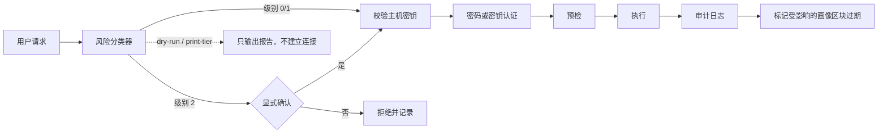

<div align="center">
  
  <br>
  <p><strong>安全优先的 Linux 服务器 SSH 运维技能。</strong><br>
  面向 Claude Code 与 Codex，让一次误操作不至于变成一次事故。</p>

  <p>
    <a href="https://github.com/youbilin/ssh-server-manager/actions/workflows/ci.yml"></a>
    <a href="LICENSE"></a>
    
    
    <a href="https://github.com/youbilin/ssh-server-manager/stargazers"></a>
  </p>

  <p>
    <a href="#快速开始">快速开始</a> ·
    <a href="#安装">安装</a> ·
    <a href="https://github.com/youbilin/ssh-server-manager/releases">发布版本</a> ·
    <a href="#工作原理">工作原理</a> ·
    <a href="#安全模型">安全模型</a> ·
    <a href="#脚本参考">脚本</a> ·
    <a href="#兼容性">兼容性</a> ·
    <a href="#常见问题">常见问题</a>
  </p>
  <p><a href="README.md">English</a> · 简体中文</p>
</div>

---

## 为什么做这个

大多数 SSH 工具优化的目标是**把命令跑起来**。这个技能优化的目标是**事后不后悔**。

远程运维的失败通常来自三个具体场景，本技能为每一个都提供了机制，而不是依赖模型“记住规则”：

| 失败模式 | 实际问题 | 本技能的机制 |
|---|---|---|
| 远程操作难以撤销 | 本地 `rm` 也许还有快照，远程 `rm -rf` 通常什么都没有 | 风险分级；危险命令默认拒绝，除非显式确认 |
| SSH／网络改动把人锁在门外 | 一个写错的 `sshd_config` 或一条防火墙 flush，就只剩云控制台可用 | 备份、语法检查、自动回滚定时器，以及明确的后备通道 |
| 批量操作放大错误 | 在 50 台机器上执行错一条命令，就是一次事故 | 目标清单预览、显式 `--yes`、并发上限、逐主机失败报告 |

最终得到的是一个像谨慎工程师那样工作的运维技能：**先观察，说明影响，再动手，验证结果，留下记录。**

## 能做什么

| 能力 | 说明 | 实际效果 |
|---|---|---|
| **安全闸门** | 只读／变更／危险三级分类 | 危险操作必须 `--confirm-danger`；只读检查直接执行 |
| **密码优先认证** | 不需要先配密钥 | 使用 OpenSSH 自带的 `SSH_ASKPASS`；不依赖 `sshpass`，密码不进入 argv、history 或审计日志 |
| **精确主机密钥** | 首次连接是一个明确的信任决定 | `--show-host-key` 查看指纹，`--accept-host-key --fingerprint SHA256:…` 只写入匹配的那一把密钥 |
| **可审计执行** | 每条经封装的命令都有记录 | `时间 \| 主机 \| 风险级别 \| 返回码 \| 耗时 \| 命令`，转义后追加写入 |
| **服务器画像** | 只勘察一次，之后读缓存 | 硬件、磁盘、网络、服务、Docker、sshd 基线；按端口分文件；指纹优先的身份判定 |
| **健康巡检** | 看当前状态，而不是重新盘点 | CPU、内存、磁盘／inode、端口、失败的 systemd/OpenRC 单元、Docker、更新、结论 |
| **可审计传输** | 文件传输走同一条安全通道 | `--upload` / `--download` / `--recursive`，支持 scp 或 rsync，包含密码与主机密钥检查 |
| **批量执行** | 一条命令跑多台 | 按标签／别名选机、目标预览、失败清单、独立日志、JSON 摘要 |
| **跨平台** | macOS、Linux、Windows Git-Bash | Bash 3.2+；systemd Linux 与 Alpine/OpenRC（需 bash）；离线测试与 CI |

## 在 GitHub 上使用

这个仓库同时提供 Claude Code 和 Codex 两个构建。最常见的使用方式是直接下载发布包：

1. 打开 [Releases](https://github.com/youbilin/ssh-server-manager/releases)，选择最新版本。
2. 根据你使用的工具下载对应资产（`.zip` 与 `.tar.gz` 内容相同，任选其一）：
   - Claude Code：`ssh-server-manager-claude-v1.0.0.zip` 或 `.tar.gz`
   - Codex：`ssh-server-manager-codex-v1.0.0.zip` 或 `.tar.gz`
3. 解压到对应的技能目录，压缩包内已经包含顶层 `ssh-server-manager/` 文件夹。
4. 在 Claude Code 或 Codex 中用自然语言提出需求即可触发，不需要斜杠命令。

具体的解压命令、目录位置和校验方式见[从发布包安装](#从发布包安装推荐)。

想跟随最新代码，可以用 `git clone` 安装（见[安装](#安装)）；想参与改进，欢迎提交 Issue 和 PR。
仓库中的 `evals/` 提供触发与行为评估样例，`tests/` 是无需真实服务器的离线回归测试。

## 工作原理



这个顺序是刻意设计的：`--dry-run`、`--print-tier` 和 `--selftest` 从不读取凭据、也不建立连接；危险命令在**任何认证之前**就会被拒绝；stdout 与 stderr 分离，结构化数据（画像、健康报告）不会被 SSH 警告污染。

## 快速开始

把 `SKILL_DIR` 设为技能安装目录，之后可以在任意工作目录执行。

```bash
SKILL_DIR="$HOME/.claude/skills/ssh-server-manager"
```

**1. 检查本地环境。** 不连接任何服务器。

```bash
bash "$SKILL_DIR/scripts/ssh_exec.sh" --selftest
```

**2. 首次连接前核对主机密钥。** 将打印出的指纹与云控制台或管理员记录比对。

```bash
bash "$SKILL_DIR/scripts/ssh_exec.sh" -H 203.0.113.10 --show-host-key
bash "$SKILL_DIR/scripts/ssh_exec.sh" -H 203.0.113.10 \
  --accept-host-key --fingerprint SHA256:xxxx
```

**3. 使用密码登录。** 密码提示不会进入 shell 历史。

```bash
bash "$SKILL_DIR/scripts/ssh_exec.sh" -H 203.0.113.10 -u root \
  --prompt-credential -c 'uptime'
```

可选：按目标保存密码，之后显式复用。

```bash
bash "$SKILL_DIR/scripts/ssh_exec.sh" -H 203.0.113.10 -u root \
  --prompt-credential --save-credential -c 'uptime'
bash "$SKILL_DIR/scripts/ssh_exec.sh" -H 203.0.113.10 -u root \
  --use-saved-credential -c 'uptime'
```

**4. 首次接触：采集只读画像并打印概览。**

```bash
bash "$SKILL_DIR/scripts/profile_store.sh" collect -H 203.0.113.10 -u root \
  --prompt-credential --note "prod web frontend"
```

```text
═══ 服务器画像 ═══
  系统             Ubuntu 24.04.4 LTS
  内核             Linux 6.8.0-xx-generic
  服务管理         systemd
  虚拟化           kvm
  CPU              Intel(R) Xeon(R) Platinum
  内存MB           16384
  机型             Alibaba Cloud ECS
  主IP             10.0.0.12
  Docker           present
  容器              6 个
  systemd服务       21 个在跑
  延迟avg          12
  上次采集         2026-10-22T06:00:00Z
```

以上输出仅为示例。`show --short` 会从本地画像文件渲染出同样的结构。

**5. 需要时查看当前状态。**

```bash
bash "$SKILL_DIR/scripts/ssh_exec.sh" -H 203.0.113.10 \
  -f "$SKILL_DIR/scripts/health_check.sh" -t 180
```

报告最后一行是机器可读的结论：

```text
SSHMGR_VERDICT=OK|WARN|CRIT
```

**6. 可审计的文件传输。**

```bash
bash "$SKILL_DIR/scripts/ssh_exec.sh" -H 203.0.113.10 \
  --upload ./app.tar.gz /tmp/app.tar.gz
bash "$SKILL_DIR/scripts/ssh_exec.sh" -H 203.0.113.10 \
  --download /var/log/app.log ./
```

**7. 批量执行先预览。**

```bash
bash "$SKILL_DIR/scripts/batch_run.sh" \
  --inventory "$SKILL_DIR/assets/inventory.example.yaml" --tags web \
  --cmd 'systemctl is-active nginx' --parallel 5 --dry-run
```

## 安装

仓库包含同一个技能的两个构建。脚本、参考文档和资源逐字节一致，只有 `SKILL.md` 和 Codex 的界面元数据不同。

| 工具 | 构建 | 安装位置 |
|---|---|---|
| Claude Code | 仓库根目录 | `~/.claude/skills/ssh-server-manager` |
| Codex | [`codex/`](codex/) | `~/.agents/skills/ssh-server-manager` |

### 从发布包安装（推荐）

打开 [最新发布](https://github.com/youbilin/ssh-server-manager/releases/latest)，下载对应工具的压缩包：

| 工具 | 资产 | 解压到 |
|---|---|---|
| Claude Code | `ssh-server-manager-claude-<version>.zip`（或 `.tar.gz`） | `~/.claude/skills/` |
| Codex | `ssh-server-manager-codex-<version>.zip`（或 `.tar.gz`） | `~/.agents/skills/` |

压缩包内包含顶层 `ssh-server-manager/` 目录，直接解压到技能目录即可得到正确结构。需要完整性校验时，核对 `SHA256SUMS`。

```bash
VERSION=v1.0.0

# Claude Code（macOS / Linux）
mkdir -p ~/.claude/skills
unzip "ssh-server-manager-claude-$VERSION.zip" -d ~/.claude/skills/
# 或者：tar -xzf "ssh-server-manager-claude-$VERSION.tar.gz" -C ~/.claude/skills/

# Codex
mkdir -p ~/.agents/skills
unzip "ssh-server-manager-codex-$VERSION.zip" -d ~/.agents/skills/
```

```bash
# 校验下载的资产
sha256sum -c SHA256SUMS          # Linux / Git-Bash
shasum -a 256 -c SHA256SUMS      # macOS
```

在 Windows Git-Bash 中，路径使用 `"$USERPROFILE/.claude/skills"` 和 `"$USERPROFILE/.agents/skills"`。如果没有 `unzip`，使用 `tar -xzf` 解压 `.tar.gz` 包。

解压后启动 Claude Code 或 Codex，直接用自然语言提问即可，例如：
“登录 203.0.113.10，用 root 密码，看看磁盘和 nginx 状态。” 技能描述会触发对应流程，不需要斜杠命令。

### Claude Code（从源码安装）

```bash
# macOS / Linux
git clone https://github.com/youbilin/ssh-server-manager.git \
  ~/.claude/skills/ssh-server-manager

# Windows Git-Bash
git clone https://github.com/youbilin/ssh-server-manager.git \
  "$USERPROFILE/.claude/skills/ssh-server-manager"
```

如果工作副本放在别处，也可以使用符号链接。`SKILL.md` 必须位于安装目录的根层。

### Codex（从源码安装）

```bash
git clone https://github.com/youbilin/ssh-server-manager.git /tmp/ssm
mkdir -p ~/.agents/skills
cp -r /tmp/ssm/codex ~/.agents/skills/ssh-server-manager
```

如果只想在单个项目中使用，把 `codex/` 复制到 `<仓库>/.agents/skills/ssh-server-manager`。Codex 会从项目 `.agents/skills` 向上扫描到仓库根目录，同时也会读取 `~/.agents/skills`。

### 首次运行

```bash
bash "$SKILL_DIR/scripts/ssh_exec.sh" --selftest
```

自检会报告 ssh 二进制与版本、askpass 支持、`/dev/tcp`、GNU `timeout` 或内置 watchdog、辅助工具、ControlMaster 目录，以及透明代理检测结果。

## 核心工作流

| 场景 | 从哪里开始 |
|---|---|
| **网站返回 502** | 先统计 `access.log` 中的 502 数量、读取 `error.log`、检查上游服务和端口，再看资源。不要先重启服务。 |
| **磁盘满了** | 先区分磁盘耗尽与 inode 耗尽；用 `du -x` 逐层定位；用 `lsof +L1` 检查已删除但仍被打开的文件；从风险最低的清理项开始。 |
| **服务挂了** | 重启前先读 `journalctl -u <svc>`（OpenRC 则读服务日志）；排查端口冲突、配置语法、权限、SELinux/AppArmor、依赖关系。 |
| **部署新版本** | 记录当前 commit，备份配置，检查即将拉取的提交，`git pull --ff-only`，reload，健康检查，并保留回滚 commit。 |
| **批量打补丁** | 预览目标清单，检查可升级的包，先在一台机器试点，再用 `--parallel 1 --stop-on-error` 分批推进。 |
| **对比机器** | `profile_store.sh compare -H web1,web2` 读取本地画像，不产生网络流量。 |
| **安全加固** | 阅读 `references/hardening.md`；按可逆顺序修改 SSH／防火墙规则，并提前准备带外通道。 |

完整操作规则见 [`SKILL.md`](SKILL.md)。参考文档按需加载，不要求预先通读。

## 安全模型

### 风险分级

| 级别 | 示例 | 行为 |
|---|---|---|
| **0 — 只读** | `df`、`journalctl`、`systemctl status`、`docker ps`、`cat /etc/ssh/sshd_config` | 直接执行 |
| **1 — 变更** | `systemctl restart`、安装软件包、`chmod`、`sed -i`、`docker compose up` | 提示影响范围；自动标记受影响的画像区块过期 |
| **2 — 危险** | 递归删除、`mkfs`、`dd`、分区工具、防火墙 flush、修改 `sshd_config`／`fstab`／`sudoers`、关机／重启、基准测试 | 默认拒绝，必须显式传入 `--confirm-danger` |

分类器理解命令位置和常见写入目标。它是一个**护栏，不是沙箱**：解释器单行命令（`python -c`）、动态拼接的脚本和任意二进制无法可靠分类。只是**提到**危险词的只读命令——`cat /etc/ssh/sshd_config`、`journalctl | grep reboot`、`ps aux | grep fio`——会正确保持在级别 0。

### 主机密钥

校验始终保持严格。首次连接在核对主机密钥前会按预期失败：

```bash
# 打印候选指纹，不写入任何内容。
ssh_exec.sh -H <host> --show-host-key

# 与云控制台比对后，只写入匹配的那把密钥。
ssh_exec.sh -H <host> --accept-host-key --fingerprint SHA256:...
```

`--fingerprint` 必须是完整且精确匹配的值；部分指纹、不匹配的指纹，以及与现有 `known_hosts` 条目冲突的情况都会被拒绝。跳板机是独立的信任决定，必须事先已经受信任。

### 配置变更协议

对于“写错就进不去或起不来”的文件——`sshd_config`、`nginx.conf`、防火墙规则、`fstab`、`/etc/sudoers`：

1. 备份并验证备份：`backup_config.sh -H <host> -f <path>`。
2. 语法检查：`sshd -t`、`nginx -t`、`visudo -c`、`findmnt --verify`。
3. 保持当前 SSH 会话不关闭。
4. 用 `systemd-run --on-active=...` 设置自动回滚定时器，验证成功后再取消。
5. 优先 reload 而不是 restart，并从第二个会话验证。
6. 提前告知用户带外后备通道（VNC／控制台）。

### 服务器画像

画像只存储**变化缓慢的事实**：硬件、磁盘、网络、服务、Docker、sshd 基线。快速变化的状态交给 `health_check.sh`。

- 保存在 `~/.ssh-server-manager/profiles/<target>.profile`，非默认 SSH 端口会加 `_<port>` 后缀。
- 身份以客户端实际验证过的主机密钥指纹为准，`machine_id` 仅作为佐证。不匹配时会保存 `.m2.profile` 并以退出码 3 结束；确认后可 `--force` 覆盖。
- 查找采用精确行匹配（`web1` 不会匹配 `web10`）；同一主机的多个端口需要 `-p` 指定。
- 局部刷新保留未受影响的区块；只有被刷新的区块会清除过期标记。
- `check` 会报告重启基线和采集以来的磁盘读写增量。

### 传输与批量

- `--upload` / `--download` 复用封装层的密码 askpass、严格主机密钥、风险分级和审计。下载默认拒绝覆盖本地路径，除非 `--force`；上传到关键远程路径需要 `--confirm-danger`。
- 直接调用 `scp` / `rsync` 会绕过封装层的审计、分级和 askpass 流程。密码认证或一次性传输请使用封装层；只有在可以接受这一权衡时，才用直接 `rsync` 做大批量工作。
- 任何变更型批量操作都要求 `--yes`；危险批量操作还需要 `--confirm-danger`。
- 逐主机日志按序号命名而非别名；每次运行使用独立目录。可用 `--json-out FILE` 生成机器可读摘要，用 `--prune-batches N` 显式清理旧批次。

## 脚本参考

所有脚本均支持 `--help`。

| 脚本 | 运行位置 | 用途 |
|---|---|---|
| [`ssh_exec.sh`](scripts/ssh_exec.sh) | 本地 | 执行封装：预检、超时、风险分级、审计、传输模式、错误诊断 |
| [`health_check.sh`](scripts/health_check.sh) | 目标机 | 只读健康报告，以 `SSHMGR_VERDICT` 结尾 |
| [`batch_run.sh`](scripts/batch_run.sh) | 本地 | 多主机执行器：目标预览、并发、失败清单、JSON 摘要 |
| [`backup_config.sh`](scripts/backup_config.sh) | 本地 + 目标机 | 带时间戳的配置备份、校验和验证、ssh 包装的恢复命令 |
| [`profile_store.sh`](scripts/profile_store.sh) | 本地 | collect、find、show、list、check、compare、set、mark-stale、forget |
| [`server_profile.sh`](scripts/server_profile.sh) | 目标机 | 只读画像采集器（通常经 `profile_store.sh` 调用） |
| [`tcping.sh`](scripts/tcping.sh) | 本地 | TCP 握手延迟探测；不产生远程负载 |

### `ssh_exec.sh`

```bash
ssh_exec.sh -H web1 -c 'df -h'                          # 只读
ssh_exec.sh -H web1 --preflight                         # 仅检查连通性
ssh_exec.sh -H web1 -f scripts/health_check.sh -t 180   # 远程执行脚本
ssh_exec.sh -H web1 --upload ./app.tgz /tmp/app.tgz     # 可审计上传
ssh_exec.sh -H web1 --download /var/log/app.log ./      # 可审计下载
ssh_exec.sh -H web1 --rsync --recursive --upload ./dist /srv/app/dist
ssh_exec.sh -H web1 --dry-run -c 'rm -rf /tmp/x'        # 不连接，不读取凭据
ssh_exec.sh --print-tier -c 'systemctl restart nginx'   # 机器可读级别：0/1/2
ssh_exec.sh -H web1 --show-host-key                     # 查看指纹，不写入
```

退出码：`0` 成功 · `124` 超时 · `4` 危险命令未确认 · `1` 用法／本地错误 · `2` 连接／认证失败 · 其他值透传自远程命令。

### `health_check.sh`

区块：`identity`、`cpu`、`memory`、`disk`、`network`、`services`、`security`、`logins`、`docker`、`updates`。

```bash
ssh_exec.sh -H web1 -f scripts/health_check.sh -A '--sections cpu,memory,disk' -t 120
ssh_exec.sh -H web1 -f scripts/health_check.sh \
  -A '--disk-warn 75 --disk-crit 85 --load-warn 1.5' -t 180
```

阈值参数：`--disk-warn/--disk-crit`、`--inode-warn/--inode-crit`、`--load-warn/--load-crit`、`--mem-warn/--mem-crit`。在目标机上直接运行时，等价的 `SSHMGR_*` 环境变量同样有效。

只有处于 `Exited`、`Restarting`、`Dead`、`Paused`、`Created` 或 `(unhealthy)` 的容器会被报告；没有健康检查的运行中容器属于正常情况。

### `batch_run.sh`

```bash
batch_run.sh --hosts 'web1 web2' --cmd 'df -h' --parallel 2
batch_run.sh --hosts-file hosts.txt --cmd 'systemctl is-active nginx'
batch_run.sh --inventory inv.yaml --tags web --cmd 'uptime' --dry-run
batch_run.sh --from-ssh-config 'web*' --cmd 'uptime'
batch_run.sh --hosts-file hosts.txt --cmd 'uptime' --json-out result.json
batch_run.sh --hosts-file hosts.txt --cmd 'uptime' --prune-batches 10
```

Inventory 条目可以设置 `auth: auto|key|password`；命令行 `--auth` 会覆盖它。

### `backup_config.sh`

```bash
backup_config.sh -H web1 -f /etc/nginx/nginx.conf
backup_config.sh -H web1 -d /etc/nginx/sites-enabled --sudo
backup_config.sh -H web1 -f /etc/nginx/nginx.conf --list
```

使用 UTC 时间戳复制文件，校验 SHA-256，并打印带 ssh 前缀的恢复命令，以及对应的语法检查和 reload 命令。`--keep N` 要求 `N >= 1`。

### `profile_store.sh`

```bash
profile_store.sh collect -H web1 --sections docker,services   # 局部刷新
profile_store.sh find | show | list | check | compare | set | mark-stale | forget
profile_store.sh check -H web1      # 重启检查 + 采集以来的磁盘 IO
profile_store.sh compare -H web1,web2
```

画像保存在 `~/.ssh-server-manager/profiles/`，格式为扁平的 `key=value`。带 `--sections` 的采集属于局部刷新：未指定的区块原样保留，只有被刷新的区块会清除过期标记。`collect` 和 `check` 会复用已存储的 user/port/jump/identity 元数据，并接受与 `ssh_exec.sh` 相同的密码参数。

## 配置

| 变量 | 默认值 | 用途 |
|---|---|---|
| `SSHMGR_HOME` | `~/.ssh-server-manager` | 审计日志、凭据、画像和 ControlMaster socket 的根目录 |
| `SSHMGR_LOG_DIR` | 同上 | `SSHMGR_HOME` 的兼容名称 |
| `SSHMGR_LOG` | `$SSHMGR_HOME/audit.log` | 显式指定审计日志路径 |
| `SSHMGR_PASSWORD` | — | 密码来源；只有在你自己的会话中已经导出时才相对安全 |
| `SSHMGR_CREDENTIAL_FILE` | — | 默认的显式凭据文件 |
| `SSHMGR_SSH` | `ssh` | 覆盖 ssh 二进制路径 |
| `SSHMGR_SCP` | `scp` | 覆盖 scp 二进制路径 |
| `SSHMGR_RSYNC` | `rsync` | 覆盖 rsync 二进制路径 |
| `SSHMGR_ASKPASS_DEBUG` | `0` | 将 askpass 提示（绝不含密码）写入 `askpass.log` |
| `SSHMGR_NO_MUX` | `0` | 禁用 ControlMaster 多路复用 |
| `SSHMGR_AUDIT_MAX_BYTES` | `0` | `audit.log` 超过该大小时轮转 |
| `SSHMGR_NO_TIMEOUT` | `0` | 强制使用内置 watchdog（测试／诊断） |
| `SSHMGR_NO_HINT` | `0` | 不在 stderr 输出画像提示 |
| `SSHMGR_REQUIRE_KEY` | `0` | 在 `health_check` 中将密码认证视为 WARN |

默认不持久化凭据。`--save-credential` 会在 `credentials.d/` 下按目标写入文件；`--use-saved-credential` 才会显式读取。旧的全局 `credentials` 文件仍可读取，但已废弃。

## 兼容性

| 组件 | 支持范围 |
|---|---|
| 本地系统 | Linux、macOS、Windows Git-Bash |
| 本地 shell | Bash 3.2+（推荐 4+；测试套件在 macOS 的 3.2 上运行） |
| 目标系统 | systemd Linux：Ubuntu/Debian、RHEL/CentOS/Rocky/Alma；安装了 bash 的 Alpine/OpenRC |
| 远程 shell | `bash`（`ssh host bash -s`）；Alpine 需要 `apk add bash` |
| 认证方式 | 密码（`SSH_ASKPASS`）、密钥／agent、`keyboard-interactive` 回退；不使用 `sshpass` |
| 文件传输 | 需要 `scp`；`rsync` 可选 |
| 可选工具 | `python3` + PyYAML（inventory 解析与 `--json-out`）；`rsync`（`--rsync`） |
| 不支持 | 只有 ash 的 Alpine、非 Linux 目标机、交互式 TUI 会话 |

Windows 上必须在 **Git-Bash** 中运行，而不是 PowerShell 的原生 OpenSSH 客户端。原生 `ssh.exe` 无法执行 POSIX askpass 辅助程序；`--selftest` 会检测并报告这种情况。

## 安全设计

- **不使用 `sshpass -p`。** 密码通过私有 askpass 辅助程序和一个退出时删除的临时密码文件传给 ssh，不会进入 argv、shell 历史、审计日志或画像。
- **默认不持久化。** `--save-credential` 需要显式启用，并按目标写入 `credentials.d/`。同一操作系统用户下的任何进程都能读取它；文件权限并不是安全边界。
- **严格主机密钥。** 首次连接必须显式提供指纹；封装层不会关闭校验，也不会写入未经验证的密钥。
- **画像与日志属于基础设施数据。** 它们包含 IP、主机名、镜像列表和服务清单，存放在 `~/.ssh-server-manager/` 下，不会进入 git。
- **绝不 `source` 或 `eval` 画像值。** 这些值来自目标主机；画像解析逐行进行，并校验键名。
- **Git-Bash 下的 `chmod 600` 经常无效。** 带 `noacl` 的挂载点不遵循 POSIX 权限位；脚本会报告实际测量到的权限，而不是打印一个令人安心的 `0600`。
- **不是沙箱。** `--confirm-danger` 是模型仍然可以传入的护栏，人的确认才是真正的闸门。审计日志只能追加，不具备防篡改能力；有合规要求时请将其转发到外部系统。
- **直接调用 `scp`/`rsync` 会绕过封装层的审计与 askpass 流程。** 需要这些属性时，请使用 `ssh_exec.sh --upload/--download`。

## 测试

```bash
bash tests/run.sh
```

测试套件不需要网络和真实主机：使用伪造的 `ssh`、`ssh-keyscan`、`scp`、`rsync`、`docker`，主机密钥在本地生成。覆盖风险分类、凭据生命周期、精确主机密钥匹配、画像的端口／查找／过期／身份／IO 行为、可审计传输、Docker 健康判断、批量 JSON／清理／确认、OpenRC 服务检测，以及评估样例的结构。

CI 在 Ubuntu、macOS 和 Windows Git-Bash 上运行，另外还有 `shellcheck`、BSD/onetrue-awk 画像检查，以及 Codex 副本同步检查。

完整技能也在一台真实的 Debian 13 主机上做过冒烟测试（密码认证、健康检查、画像采集、scp 单文件／递归／含空格路径传输，以及 mux 回退）。这部分不在 CI 中运行，因为需要凭据和在线主机。

## 设计取舍

- **用 Bash，而不是 Python 框架。** 本地脚本只需 `ssh`/`scp` 即可在 macOS、Linux 和 Git-Bash 上运行；Python 是可选的。
- **密码优先，而非密钥优先。** 一次性登录不应该先走一遍密钥仪式。密钥受支持，但绝不强制。
- **能力探测，而非按发行版分支。** 目标机脚本优先使用 `systemctl`，回退到 OpenRC；缺少完整工具时使用 BusyBox 兼容路径。
- **画像是缓存，不是资产管理系统。** 只存变化缓慢的事实；快速变化的状态交给 `health_check.sh`。
- **只读采集器。** `health_check.sh` 和 `server_profile.sh` 带有 `# sshmgr:read-only` 标记；封装层会拒绝把任意本地脚本当作只读脚本。
- **不做基准测试。** `sysbench`、`fio`、`stress-ng`、`iperf3`、`dd` 写测试等默认被拒绝；生产环境压测会污染监控指标，甚至引发故障。

## 已知限制

- 风险分类器是启发式的。动态代码、别名和复杂的 shell 组合无法可靠分类。
- 直接调用 `scp`/`rsync` 不进入审计；需要审计时请使用传输模式。
- 审计日志只能追加，但不具备防篡改能力。
- 真实环境覆盖范围是一台 Debian 13 主机加 CI 伪造环境；Ubuntu/RHEL、跳板机、非 22 端口、真实 OpenRC 主机和目标机上的 rsync 仍值得进一步实测。
- 未覆盖 Alpine 边缘情况（`awall`、`doas`、非 OpenRC init 系统、BusyBox `--deep`）。
- `--stop-on-error` 只停止继续派发；已经在运行的主机会执行完毕。
- `--json-out` 和 inventory 解析依赖 Python。
- 批量文件、画像和已保存凭据由操作系统的用户权限保护，而非加密。

## 常见问题

**需要安装 `sshpass` 吗？**
不需要。密码认证使用 OpenSSH 自带的 `SSH_ASKPASS` 机制。

**可以只用密码、不配密钥吗？**
可以。这是一等公民路径，绝不要求先配置密钥。

**会保存我的密码吗？**
默认不会。`--save-credential` 需要显式启用并按目标保存；`--use-saved-credential` 同样需要显式调用。

**为什么第一次连接失败？**
严格的主机密钥校验是刻意的设计。先运行 `--show-host-key`，比对指纹，再使用 `--accept-host-key --fingerprint`。

**支持 Alpine 吗？**
支持，但目标机需要先 `apk add bash`。远程脚本通过 `bash -s` 执行，因此只有 ash 的 Alpine 不受支持。

**这是沙箱吗？**
不是。这是一个安全优先的运维技能。风险闸门和审计日志减少失误，但不能替代人工审查和最小权限原则。

**和直接用 `ssh` 有什么区别？**
它增加了风险分级、精确主机密钥接受、无需 `sshpass` 的密码处理、审计日志、画像缓存、结构化健康检查、可审计传输和批量失败报告。

## 文档

| 文档 | 内容 |
|---|---|
| [`README.md`](README.md) | English documentation |
| [`SKILL.md`](SKILL.md) | 模型加载的操作规则 |
| [`references/troubleshooting.md`](references/troubleshooting.md) | 按症状索引的手册：连接、磁盘／inode 耗尽、服务、502/504、负载、OOM、端口、证书、容器 |
| [`references/common-commands.md`](references/common-commands.md) | 按场景分组的命令，含 OpenRC 与 apk 等价写法 |
| [`references/hardening.md`](references/hardening.md) | 按风险排序的加固清单，附锁定风险提示 |
| [`references/server-baseline.md`](references/server-baseline.md) | 画像字段、身份判定、新鲜度与刷新语义 |
| [`assets/inventory.example.yaml`](assets/inventory.example.yaml) | 多主机 inventory 模板，含标签、默认值和跳板机 |
| [`tests/`](tests/) | 离线回归测试套件与伪造的 SSH/Docker 二进制 |
| [`evals/`](evals/) | 技能与触发评估样例 |
| [`tools/build-codex.sh`](tools/build-codex.sh) | 重新生成并校验 Codex 共享副本 |
| [`tools/package-release.sh`](tools/package-release.sh) | 构建 Claude/Codex 发布包与 `SHA256SUMS` |

```
.
├── SKILL.md               # 技能定义与操作规则
├── README.zh-CN.md        # 中文文档
├── scripts/               # 封装层、采集器、画像、传输、批量
├── references/            # 按需加载的运维手册
├── assets/                # banner 与 inventory 模板
├── tests/                 # 离线回归测试
├── evals/                 # 评估样例
├── codex/                 # 生成的 Codex 构建（SKILL.md 单独维护）
└── tools/                 # 构建／同步辅助脚本
```

## 参与贡献

欢迎提交 Issue 和 Pull Request。提交前请运行：

```bash
bash tests/run.sh
bash tools/build-codex.sh --check
```

要求：

- 脚本必须继续兼容 Bash 3.2+、macOS、Linux 和 Windows Git-Bash。
- 只读采集器必须保留 `# sshmgr:read-only` 文件头。
- 行为变更需要补充回归测试。
- 修改共享脚本、参考文档或资源后，运行 `tools/build-codex.sh`。

## Star 历史

如果这个技能帮你避开了一次错误命令，欢迎点一个 Star。

<a href="https://star-history.com/#youbilin/ssh-server-manager&Date">
  
</a>

## 许可证

基于 [MIT License](LICENSE) 发布。Copyright © 2026 You Bilin.
